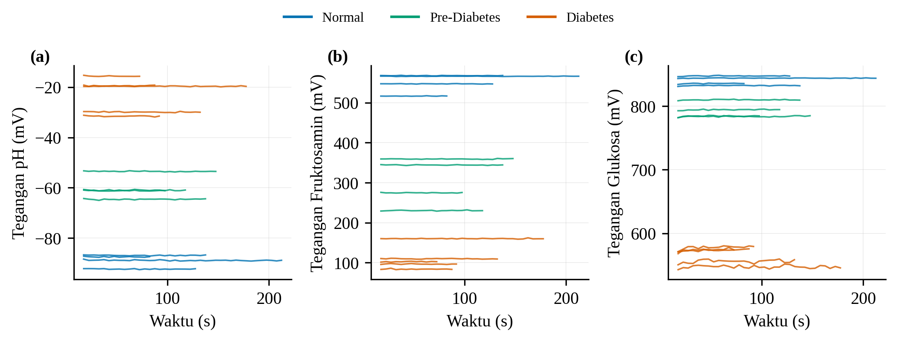
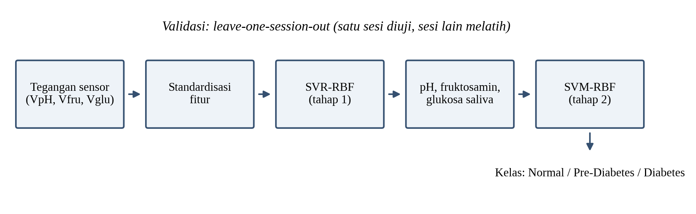
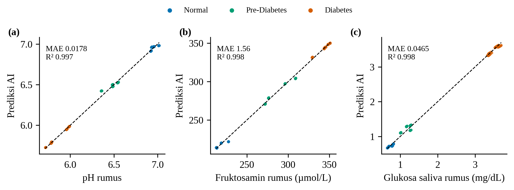
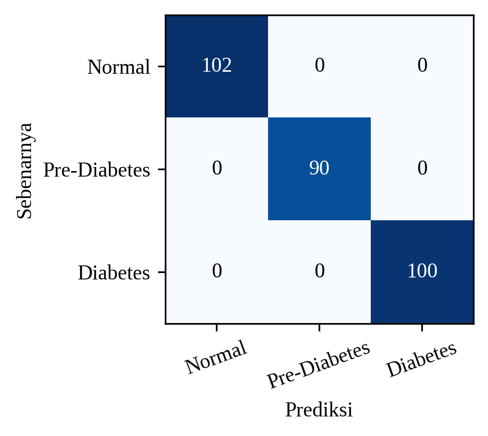

# Hasil dan Pembahasan — Pelatihan AI pada Data Optimal (SIMULASI)

> **Label wajib.** Seluruh data di bagian ini adalah simulasi kondisi optimal (dibuat dari rumus `main.cpp`
> dan target per kelas), bukan hasil ukur alat. Pada Pre-Diabetes, 3 dari 4 sesi dibuat tambahan oleh generator
> yang sama karena log asli hanya punya satu rekaman singkat. Tempatkan sebagai "demonstrasi alur pelatihan
> dan target optimasi", jangan sebagai bukti kinerja alat.
> Angka di bawah dihasilkan `latih_ai_optimal.py`.

### Pola Tegangan Tiga Kelas pada Kondisi Optimal

Pada kondisi optimal, tegangan ketiga kanal membentuk tiga tingkat yang terpisah untuk kelas normal, prediabetes, dan diabetes (Gambar 9). Setelah fase transien 15 detik pertama, sinyal tiap sesi datar dan berbeda antar kelas secara berurutan. Tegangan pH naik dari −89,0 mV (normal) ke −59,8 mV (prediabetes) dan −23,5 mV (diabetes). Tegangan fruktosamin turun dari 555,2 mV ke 308,8 mV dan 119,3 mV, dan tegangan glukosa turun dari 840,7 mV ke 793,6 mV dan 561,4 mV (Tabel 1). Urutan ini mengikuti arah rumus konversi pada firmware: makin tinggi fruktosamin dan glukosa saliva serta makin rendah pH, tegangan kanal makin kecil untuk fruktosamin dan glukosa, dan makin tinggi untuk pH.

**Gambar 9.** Tegangan (a) pH, (b) fruktosamin, dan (c) glukosa terhadap waktu pada kondisi optimal (simulasi). Setiap garis adalah satu sesi (rata-rata jendela 5 detik).

**Tabel 1.** Tegangan dan nilai biomarka per kelas pada kondisi optimal (simulasi), rerata ± SD antar-jendela (n = 292 jendela dari 13 sesi).

| Kelas | Sesi | VpH (mV) | Vfru (mV) | Vglu (mV) | pH | Fruktosamin (µmol/L) | Glukosa saliva (mg/dL) |
|---|---|---|---|---|---|---|---|
| Normal | 4 | −89,0 ± 2,0 | 555,2 ± 17,5 | 840,7 ± 6,0 | 6,96 ± 0,03 | 216,6 ± 5,0 | 0,73 ± 0,06 |
| Prediabetes | 4 | −59,8 ± 4,4 | 308,8 ± 52,9 | 793,6 ± 11,0 | 6,46 ± 0,07 | 286,3 ± 15,1 | 1,17 ± 0,11 |
| Diabetes | 5 | −23,5 ± 5,9 | 119,3 ± 29,8 | 561,4 ± 12,7 | 5,85 ± 0,10 | 340,8 ± 8,5 | 3,51 ± 0,13 |

### Pelatihan AI untuk Menghasilkan pH, Fruktosamin, dan Glukosa Saliva

Pelatihan AI dibagi dalam dua tahap (Gambar 10). Pada tahap pertama, tiga tegangan (VpH, Vfru, Vglu) distandardisasi lalu dimasukkan ke *Support Vector Regression* (SVR) berkernel RBF (C = 100, γ = *scale*) yang dilatih terpisah untuk tiga target, yaitu pH, fruktosamin (µmol/L), dan glukosa saliva (mg/dL). Pada tahap kedua, *Support Vector Machine* (SVM) berkernel RBF mengklasifikasikan tegangan yang sama ke kelas normal, prediabetes, atau diabetes. Seluruh data dibagi per sesi, dan model dievaluasi dengan *leave-one-session-out* sehingga sesi yang diuji tidak pernah dilihat saat pelatihan. Data berasal dari 292 jendela 5 detik pada 13 sesi.

**Gambar 10.** Alur pelatihan AI: tegangan sensor dikonversi SVR menjadi pH, fruktosamin, dan glukosa saliva, kemudian SVM menentukan kelas. Evaluasi memakai *leave-one-session-out*.

Pada sesi yang tidak dilatihkan, SVR menghasilkan nilai yang sangat dekat dengan hasil rumus (Gambar 11). Galat absolut rerata (MAE) sebesar 0,018 untuk pH, 1,56 µmol/L untuk fruktosamin, dan 0,047 mg/dL untuk glukosa saliva, atau sekitar 1,1–1,5% dari rentang masing-masing parameter, dengan R² ≥ 0,997 (Tabel 2). Klasifikasi SVM memisahkan ketiga kelas tanpa kesalahan pada seluruh 292 jendela (akurasi dan *macro F1-score* 100%, Gambar 12).

**Gambar 11.** Prediksi AI terhadap nilai hasil rumus untuk (a) pH, (b) fruktosamin, dan (c) glukosa saliva pada sesi yang tidak dilatihkan. Garis putus-putus adalah kesesuaian sempurna.

**Tabel 2.** Galat regresi tegangan → nilai biomarka pada *leave-one-session-out* (simulasi).

| Parameter | Model | MAE | R² |
|---|---|---|---|
| pH | SVR-RBF | 0,018 | 0,997 |
| pH | Regresi linear | 0,0007 | 1,000 |
| Fruktosamin (µmol/L) | SVR-RBF | 1,56 | 0,998 |
| Fruktosamin (µmol/L) | Regresi linear | 0,20 | 1,000 |
| Glukosa saliva (mg/dL) | SVR-RBF | 0,047 | 0,998 |
| Glukosa saliva (mg/dL) | Regresi linear | 0,007 | 1,000 |

**Gambar 12.** *Confusion matrix* SVM tiga kelas pada *leave-one-session-out* (simulasi, n = 292).

### Pembahasan

Hasil ini harus dibaca sebagai demonstrasi alur, bukan sebagai bukti kinerja. Tiga hal membatasi tafsirannya.

Pertama, regresi linear sudah menghasilkan galat hampir nol dan lebih baik daripada SVR (Tabel 2). Hal ini wajar karena data optimal dibuat dari rumus yang linear, sehingga hubungan tegangan dan nilai biomarka memang linear sempurna. SVR hanya perlu mendekati garis lurus dan menyisakan galat kecil. Pada data simulasi ini, AI belum memberi nilai tambah dibanding rumus kalibrasi.

Kedua, klasifikasi sempurna tidak bersifat informatif. Ketiga kelas dibuat dengan jarak antar kelas jauh melebihi variasi antar-sesi, sehingga pengujian tambahan menunjukkan setiap kanal tunggal (pH, fruktosamin, atau glukosa) sudah memisahkan ketiga kelas dengan akurasi 100%. Pada data nyata, variasi antar-sesi lebih besar dan kanal glukosa serta pH masih bermasalah (jenuh dan offset), sehingga kinerja akan lebih rendah dan tidak boleh disimpulkan dari angka ini. Kelas prediabetes juga hanya diwakili satu sesi simulasi lengkap ditambah tiga sesi simulasi tambahan.

Ketiga, nilai AI yang sebenarnya muncul ketika kalibrasi tidak diketahui secara analitik. Rumus pada firmware masih kalibrasi sementara, sedangkan AI dapat dilatih langsung dari pasangan tegangan dan nilai acuan yang diukur dengan cara baku, yaitu larutan buffer pH, larutan fruktosamin standar, dan glukometer untuk glukosa darah. Dengan cara itu AI menyerap nonlinearitas dan variasi antar-strip yang tidak tertangkap rumus linear. Alur pada Gambar 10 sudah siap dipakai untuk data semacam itu; yang diganti hanya sumber label dari rumus menjadi nilai acuan terukur.

Dengan demikian, data optimal berfungsi sebagai target dan uji alur: tegangan yang diharapkan pada kondisi optimal (VpH −89 hingga −23 mV, Vfru 555 hingga 119 mV, Vglu 841 hingga 561 mV) dapat dipakai sebagai kriteria penerimaan pengukuran ulang. Setelah data nyata yang memenuhi kriteria itu terkumpul, pelatihan yang sama dijalankan ulang dan hasilnya dilaporkan sebagai kinerja alat.

## Susunan satu paragraf (bila ruang terbatas)

> Pada simulasi kondisi optimal, tegangan pH, fruktosamin, dan glukosa membentuk tiga tingkat yang berurutan untuk kelas normal, prediabetes, dan diabetes (Gambar 9, Tabel 1). Tegangan ini dipakai melatih *Support Vector Regression* (RBF) untuk menghasilkan pH, fruktosamin (µmol/L), dan glukosa saliva (mg/dL), kemudian *Support Vector Machine* (RBF) untuk menentukan kelas, dengan evaluasi *leave-one-session-out* pada 13 sesi (Gambar 10). Model menghasilkan galat absolut rerata 0,018 untuk pH, 1,56 µmol/L untuk fruktosamin, dan 0,047 mg/dL untuk glukosa saliva, serta mengklasifikasikan seluruh 292 jendela dengan benar (Gambar 11–12). Karena data dibuat dari rumus linear dengan jarak antar-kelas besar, regresi linear sudah setara dan setiap kanal tunggal sudah memisahkan kelas, sehingga hasil ini menunjukkan kelayakan alur dan target optimasi, bukan kinerja alat pada sampel nyata.
