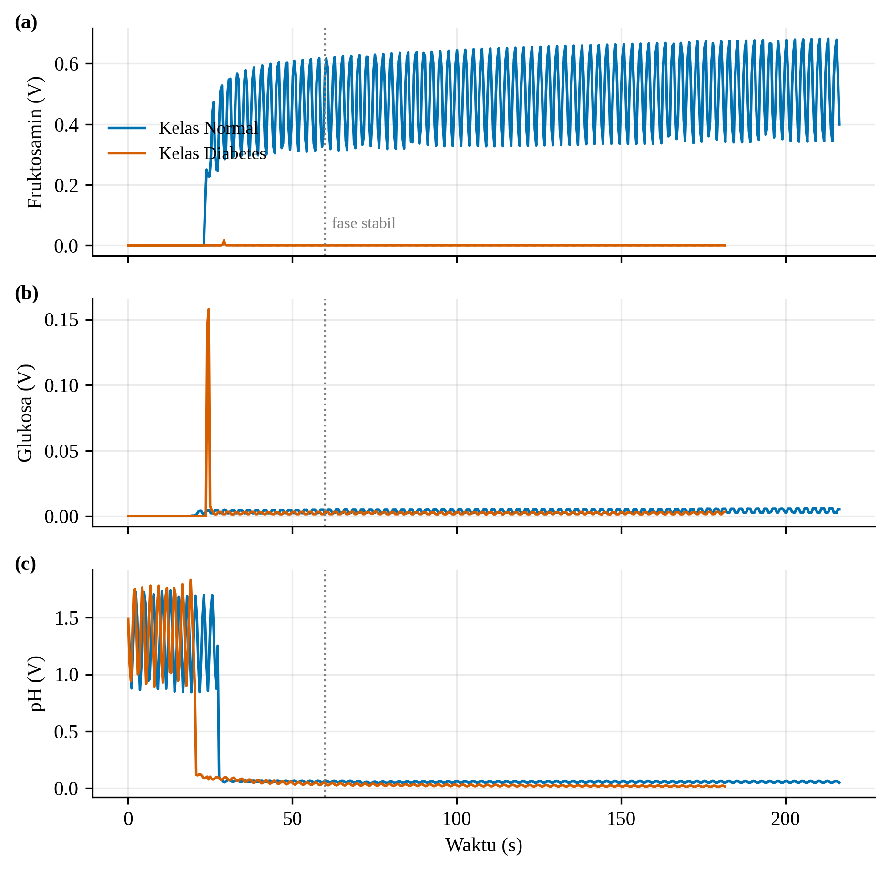
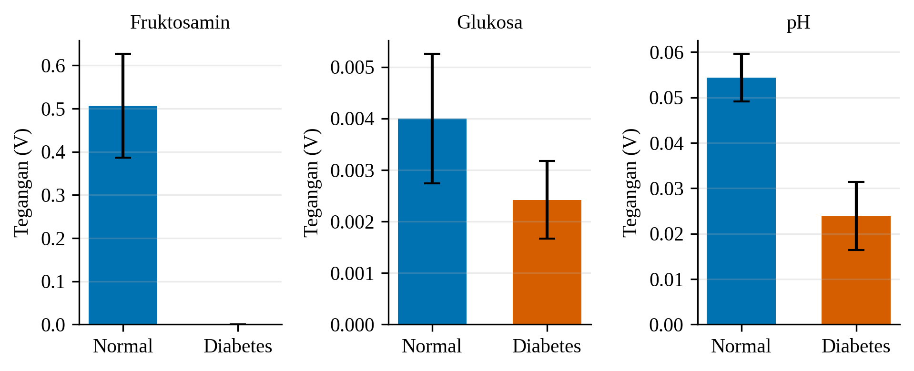
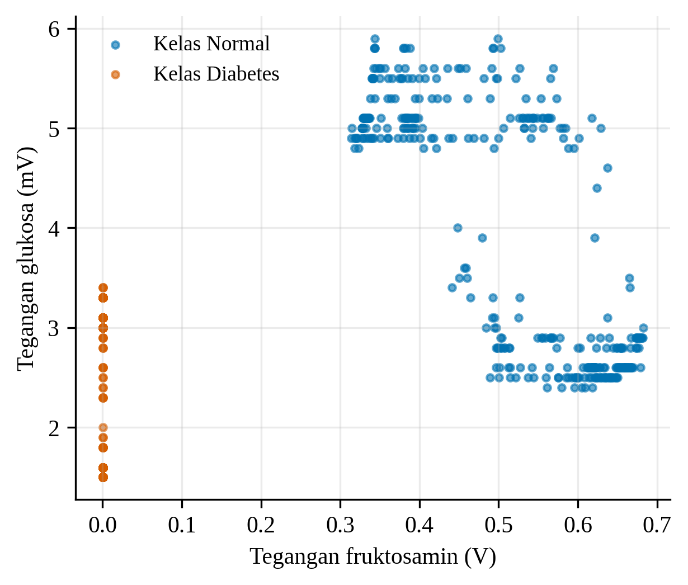

## Respons Sensor terhadap Dua Kelas Sampel

Respons sensor elektrokimia Glicovia dievaluasi pada dua kelas sampel, yaitu kelas normal dan kelas diabetes. Setiap pembacaan direkam dari tiga kanal, yaitu fruktosamin, glukosa, dan pH, dengan selang pencuplikan rata-rata 0,42 detik. Gambar 9 menunjukkan perubahan tegangan ketiga kanal terhadap waktu. Pada sekitar 30 detik pertama, seluruh kanal berada pada fase transien yang ditandai oleh nilai pH yang berfluktuasi pada rentang 0,9–1,8 V dan satu lonjakan sesaat pada kanal glukosa kelas diabetes.

**Gambar 9.** Respons tegangan sensor (a) fruktosamin, (b) glukosa, dan (c) pH terhadap waktu pada kelas normal dan kelas diabetes. Garis putus-putus menandai awal fase stabil.

Pada fase stabil, kanal fruktosamin memberikan pemisahan yang paling jelas antara kedua kelas (Tabel 1, Gambar 10). Kelas normal menghasilkan tegangan fruktosamin rata-rata 0,507 ± 0,120 V, sedangkan kelas diabetes hanya 0,0002 ± 0,0001 V, atau selisih lebih dari tiga ordo besaran. Kanal glukosa dan pH juga menunjukkan kecenderungan yang sama, yaitu tegangan kelas normal lebih tinggi daripada kelas diabetes (glukosa 4,0 ± 1,3 mV berbanding 2,4 ± 0,8 mV; pH 54,3 ± 5,3 mV berbanding 23,9 ± 7,5 mV). Namun, perbedaan pada kedua kanal ini jauh lebih kecil sehingga rentang simpangan baku kedua kelas saling mendekat, terutama pada kanal glukosa.

**Tabel 1.** Tegangan sensor pada fase stabil (t ≥ 60 s), rata-rata ± simpangan baku.

| Kanal            | Kelas normal   | Kelas diabetes   |
| ---------------- | -------------- | ---------------- |
| Fruktosamin (V)  | 0,507 ± 0,120 | 0,0002 ± 0,0001 |
| Glukosa (mV)     | 4,0 ± 1,3     | 2,4 ± 0,8       |
| pH (mV)          | 54,3 ± 5,3    | 23,9 ± 7,5      |
| Jumlah pembacaan | 370            | 288              |

**Gambar 10.** Tegangan rata-rata ± simpangan baku pada fase stabil untuk kanal fruktosamin, glukosa, dan pH.

Pola ini terlihat pada ruang fitur dua dimensi (Gambar 11). Titik-titik kedua kelas membentuk gugus yang terpisah sepenuhnya sepanjang sumbu fruktosamin, sedangkan sumbu glukosa hanya memberi pemisahan parsial. Keterpisahan tersebut menunjukkan bahwa kombinasi ketiga biomarka memuat informasi yang dapat dimanfaatkan oleh klasifikasi berbasis SVM dengan kernel RBF, sejalan dengan rancangan Glicovia yang menggabungkan beberapa parameter dalam satu proses analisis.

**Gambar 11.** Sebaran pembacaan fase stabil pada ruang fitur tegangan fruktosamin dan tegangan glukosa.

Beberapa keterbatasan perlu dicatat. Pertama, sinyal fruktosamin dan glukosa pada kelas normal memperlihatkan fluktuasi periodik dan pergeseran perlahan (*drift*) sehingga simpangan bakunya relatif besar (koefisien variasi 23,8% untuk fruktosamin); hal ini mengindikasikan bahwa kestabilan pembacaan sensor masih perlu dioptimalkan, sebagaimana telah disebutkan pada bagian kelayakan produk. Kedua, kanal arus utama pada pembacaan glukosa masih berstatus jenuh pada hampir seluruh waktu pengukuran sehingga nilai konsentrasi glukosa belum dapat dikuantifikasi langsung dari arus dan analisis di sini terbatas pada tegangan kanal. Ketiga, tegangan pH belum dikonversi menjadi nilai pH melalui kalibrasi. Karena itu, hasil ini diposisikan sebagai bukti awal kemampuan perangkat membedakan dua kelas sampel, bukan sebagai penentuan akurasi diagnostik. Kalibrasi, optimalisasi sensor, serta validasi analitik dan klinis dengan jumlah subjek yang lebih besar masih diperlukan.
