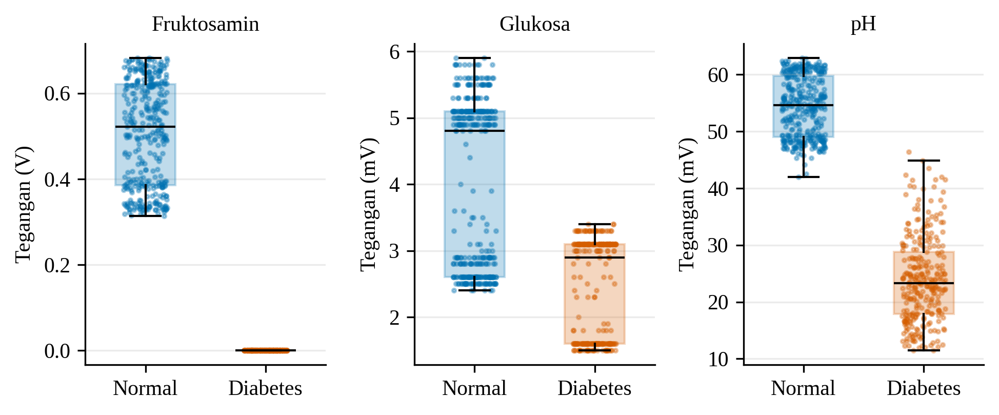
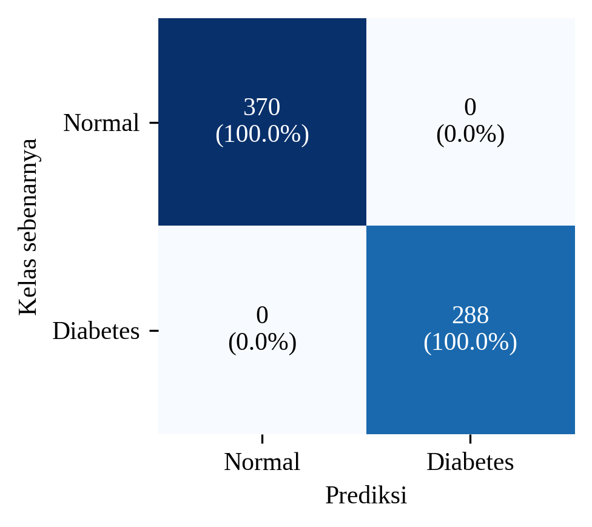
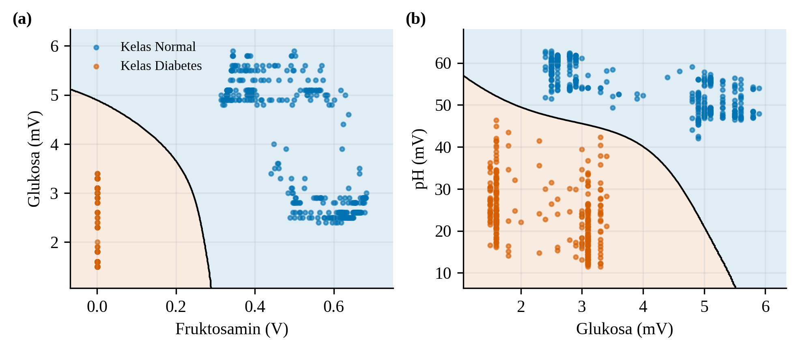
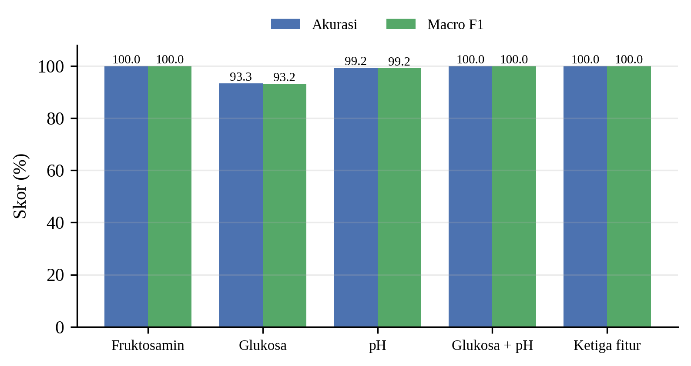

## Klasifikasi Dua Kelas Berbasis SVM pada Pembacaan Sensor

Untuk mengeksplorasi kemampuan klasifikasi Glicovia, setiap pembacaan pada fase stabil (t ≥ 60 s) diperlakukan sebagai satu sampel independen sehingga diperoleh 658 sampel, terdiri atas 370 sampel kelas normal dan 288 sampel kelas diabetes, masing-masing dengan tiga fitur, yaitu tegangan kanal fruktosamin, glukosa, dan pH. Sebaran ketiga fitur ditunjukkan pada Gambar 12. Kanal fruktosamin kelas normal berada pada rentang 0,31–0,68 V, sedangkan kelas diabetes tertahan di sekitar 0 V. Kanal pH juga memisahkan kedua kelas dengan baik, yaitu 42,0–62,9 mV pada kelas normal dan 11,5–46,4 mV pada kelas diabetes, dengan tumpang-tindih yang hanya terjadi pada sedikit sampel di rentang 42,0–46,4 mV. Sebaliknya, kanal glukosa menunjukkan tumpang-tindih yang lebih lebar pada rentang 2,4–3,4 mV karena sebagian pembacaan kelas normal turun ke rentang yang sama dengan kelas diabetes. Pembacaan glukosa juga tampak berundak pada kelipatan 0,1 mV karena nilainya sangat kecil dan dicatat dengan resolusi empat desimal dalam satuan volt.

**Gambar 12.** Sebaran tegangan kanal fruktosamin, glukosa, dan pH pada fase stabil. Setiap titik mewakili satu sampel.

Data tersebut diklasifikasikan menggunakan SVM berkernel RBF (C = 1, γ = *scale*) dengan standardisasi fitur, kemudian dievaluasi melalui *five-fold stratified cross-validation*. Model dengan ketiga fitur mencapai akurasi, *macro F1-score*, dan AUC sebesar 100% pada seluruh lipatan, tanpa kesalahan klasifikasi pada kedua kelas (Gambar 13). Batas keputusan SVM pada Gambar 14 memperlihatkan bahwa kedua gugus berada jauh dari batas pemisah, baik pada ruang fruktosamin–glukosa maupun glukosa–pH. Uji ablasi (Gambar 15) menunjukkan bahwa fruktosamin secara tunggal sudah cukup untuk mencapai akurasi 100%, pH secara tunggal mencapai 99,2%, dan glukosa secara tunggal hanya 93,3%. Kombinasi glukosa dan pH kembali mencapai 100% sehingga sistem tetap dapat membedakan kedua kelas meskipun kanal fruktosamin tidak digunakan. Waktu inferensi model pada komputer pengolah sebesar 0,54 ms per sampel.

**Gambar 13.** *Confusion matrix* SVM RBF dengan tiga fitur hasil *five-fold stratified cross-validation* (n = 658).

**Gambar 14.** Batas keputusan SVM RBF pada ruang fitur (a) fruktosamin–glukosa dan (b) glukosa–pH.

**Gambar 15.** Akurasi dan *macro F1-score* SVM untuk tiap kombinasi fitur (*five-fold stratified cross-validation*).

**Tabel 2.** Kinerja SVM RBF untuk tiap kombinasi fitur.

| Fitur | Akurasi (%) | Macro F1 (%) | AUC |
|---|---|---|---|
| Fruktosamin | 100,0 | 100,0 | 1,000 |
| Glukosa | 93,3 | 93,2 | 0,939 |
| pH | 99,2 | 99,2 | 1,000 |
| Glukosa + pH | 100,0 | 100,0 | 1,000 |
| Ketiga fitur | 100,0 | 100,0 | 1,000 |

Kinerja sempurna ini perlu ditafsirkan secara hati-hati. Seluruh sampel tiap kelas berasal dari satu rekaman kontinu pada satu cartridge sehingga titik-titik yang berdekatan saling berkorelasi dan tidak mewakili sampel saliva yang benar-benar berbeda. Dengan demikian, model pada dasarnya membedakan dua sesi pengukuran, bukan dua populasi subjek. Akurasi 100% yang tetap diperoleh ketika model dilatih pada 60% awal rekaman dan diuji pada 40% akhir menunjukkan bahwa pemisahan kedua kelas konsisten sepanjang waktu pengukuran, tetapi belum membuktikan kemampuan generalisasi ke subjek baru. Selain itu, arah perbedaannya berlawanan dengan harapan fisiologis karena kelas diabetes justru menghasilkan tegangan glukosa dan fruktosamin yang lebih rendah. Tegangan fruktosamin yang hampir nol pada kelas diabetes juga lebih menyerupai kanal yang tidak merespons dibandingkan pembacaan konsentrasi yang rendah, sementara arus utama berstatus jenuh pada hampir seluruh pengukuran. Oleh karena itu, hasil ini menunjukkan bahwa alur akuisisi sinyal hingga klasifikasi SVM Glicovia telah berfungsi dari ujung ke ujung, tetapi belum dapat dijadikan ukuran akurasi diagnostik. Pengukuran berulang dengan cartridge berbeda, kalibrasi tiap kanal, perbaikan saturasi arus, dan validasi pada subjek yang lebih banyak dengan pembagian data per subjek masih diperlukan sebelum kinerja klasifikasi dapat dinilai secara klinis.
