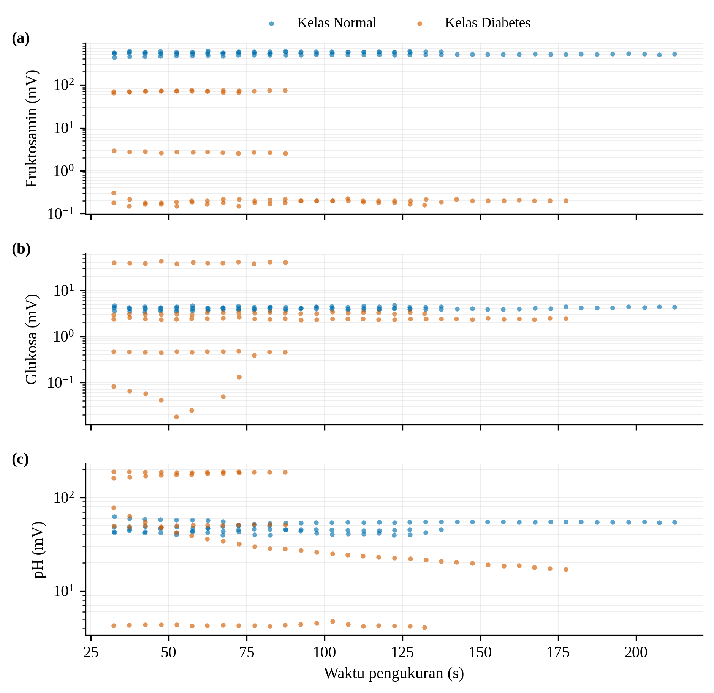
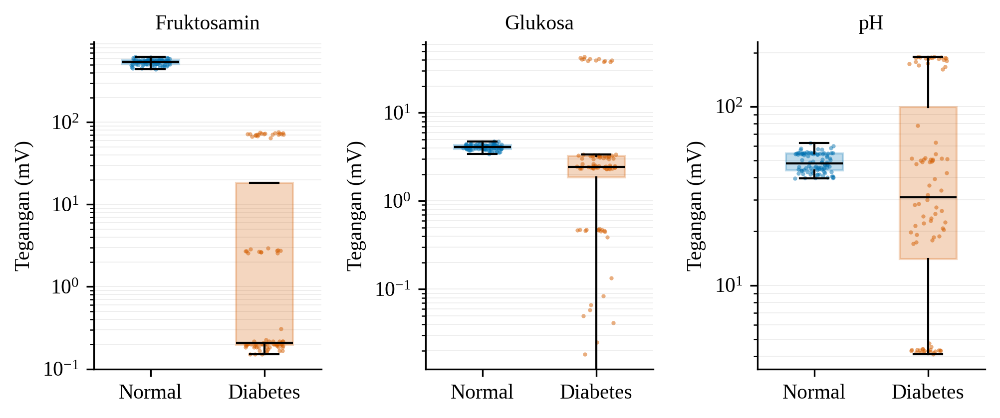
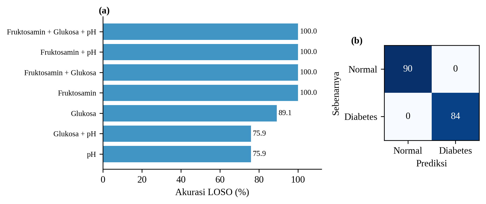
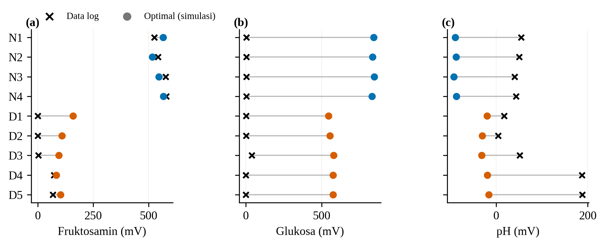

### Respons Tegangan Sensor pada Dua Kelas Data

Respons sensor dievaluasi pada sembilan sesi rekaman saliva yang diambil dengan firmware yang sama, yaitu empat sesi kelas normal (N1–N4, glukosa darah 88 mg/dL) dan lima sesi kelas diabetes (D1–D5, 148 mg/dL). Rekaman yang terlalu pendek, termasuk satu rekaman prediabetes, tidak diikutsertakan. Seluruh kanal melewati fase transien sekitar 30 detik pertama sehingga bagian tersebut dibuang. Sisa rekaman dirata-ratakan per jendela 5 detik, dan tiap jendela disebut satu pengambilan data. Cara ini menghasilkan 174 pengambilan data (90 pada kelas normal dan 84 pada kelas diabetes). Gambar 9 memperlihatkan bahwa perbedaan tegangan kedua kelas bertahan sepanjang waktu pengukuran. Perbedaan paling jelas terlihat pada fruktosamin, dengan median 543 mV pada kelas normal dan 0,21 mV pada kelas diabetes (Tabel 1). Tegangan glukosa dan pH kelas normal juga lebih tinggi, yaitu 4,11 mV dan 48,1 mV, berbanding 2,44 mV dan 31,0 mV pada kelas diabetes.

**Tabel 1.** Median tegangan [kuartil 1–kuartil 3] per kelas pada 174 pengambilan data.

| Kanal | Normal (mV) | Diabetes (mV) |
|---|---|---|
| Fruktosamin | 543,4 [508,5–576,2] | 0,21 [0,20–18,4] |
| Glukosa | 4,11 [3,91–4,32] | 2,44 [1,85–3,23] |
| pH | 48,1 [43,8–54,6] | 31,0 [14,0–98,8] |

**Gambar 9.** Tegangan (a) fruktosamin, (b) glukosa, dan (c) pH terhadap waktu pengukuran pada kelas normal dan kelas diabetes. Setiap titik adalah satu pengambilan data (rata-rata 5 detik); sumbu tegangan berskala logaritmik.

Sebaran pada Gambar 10 menunjukkan bahwa kelas normal menghasilkan tegangan yang sempit dan stabil pada ketiga parameter, sedangkan kelas diabetes lebih bervariasi (fruktosamin 0,15–75,5 mV dan pH 4,1–189,0 mV). Kanal fruktosamin memisahkan kedua kelas tanpa tumpang-tindih, sedangkan kanal glukosa dan pH masih saling tumpang-tindih. Tegangan glukosa yang sangat kecil juga menandakan bahwa keluaran penguat transimpedansi pada kanal ini berada di bawah 0,05 V pada hampir seluruh pembacaan (status jenuh). Artinya, arus glukosa melampaui rentang ukur penguat sehingga tegangan tersebut belum mencerminkan kadar glukosa saliva.

**Gambar 10.** Sebaran tegangan fruktosamin, glukosa, dan pH pada kelas normal dan kelas diabetes (skala logaritmik).

### Klasifikasi Kelas Normal dan Diabetes Berbasis SVM

Pengambilan data diklasifikasikan menggunakan SVM berkernel RBF (C = 1, γ = *scale*) dengan logaritma dan standardisasi fitur. Karena seluruh pengambilan data dari satu sesi berasal dari sampel yang sama, evaluasi memakai skema *leave-one-session-out*, yaitu setiap sesi bergantian menjadi data uji dan model dilatih dari delapan sesi lainnya. Skema ini mencegah informasi satu sesi bocor ke data latih, sehingga hasilnya lebih ketat daripada validasi silang acak. Dengan ketiga fitur, model mengklasifikasikan seluruh 174 pengambilan data dengan benar (akurasi dan *macro F1-score* 100%, Gambar 11b). Uji ablasi pada Gambar 11a menunjukkan bahwa fruktosamin secara tunggal sudah mencapai akurasi 100%, sedangkan glukosa secara tunggal mencapai 89,1% dan pH secara tunggal 75,9%. Kombinasi glukosa dan pH hanya mencapai 75,9% dan gagal pada dua sesi, sehingga kinerja model pada data ini bertumpu pada kanal fruktosamin (Tabel 2).

**Tabel 2.** Kinerja SVM RBF dengan *leave-one-session-out* untuk tiap kombinasi fitur (n = 174, 9 sesi).

| Fitur | Akurasi (%) | Macro F1 (%) | Akurasi sesi terburuk (%) |
|---|---|---|---|
| Fruktosamin | 100,0 | 100,0 | 100,0 |
| Glukosa | 89,1 | 88,9 | 9,5 |
| pH | 75,9 | 73,9 | 0,0 |
| Fruktosamin + Glukosa | 100,0 | 100,0 | 100,0 |
| Fruktosamin + pH | 100,0 | 100,0 | 100,0 |
| Glukosa + pH | 75,9 | 73,9 | 0,0 |
| Fruktosamin + Glukosa + pH | 100,0 | 100,0 | 100,0 |

**Gambar 11.** (a) Akurasi SVM untuk tiap kombinasi fitur dan (b) *confusion matrix* dengan tiga fitur, keduanya dari *leave-one-session-out*.

Hasil ini perlu ditafsirkan hati-hati. Pertama, hanya terdapat sembilan sesi sehingga setiap kelas dan setiap sesi sangat menentukan hasil. Kedua, tegangan fruktosamin kelas diabetes mendekati 0 V, kondisi yang juga dapat muncul akibat kontak elektroda atau kerja penguat, sehingga pemisahan sempurna ini belum dapat dipastikan berasal dari kadar fruktosamin saliva dan perlu dikonfirmasi dengan larutan standar serta lebih banyak subjek. Ketiga, kelas prediabetes belum tercakup karena data yang tersedia terlalu singkat.

### Validasi Rumus Konversi dan Target Optimasi Sensor

Untuk mengetahui seberapa jauh pembacaan saat ini dari kondisi yang diharapkan, dibuat contoh data optimal berbasis simulasi. Setiap sesi di atas disimulasikan ulang dengan tegangan yang menghasilkan nilai biomarka tipikal tiap kelas (pH 6,94 dan 5,88; fruktosamin 224 dan 350 µmol/L; glukosa saliva 0,67 dan 3,31 mg/dL untuk kelas normal dan diabetes), kemudian dikonversi kembali memakai rumus pada firmware. Konversi tegangan ke satuan riil terbukti linear dengan sensitivitas −59,16 mV/pH, −3,51 mV per µmol/L fruktosamin, dan −100,4 mV per mg/dL glukosa saliva, sesuai parameter firmware. Karena data optimal dibuat dari rumus yang sama, korelasi yang sangat tinggi antara tegangan dan nilai biomarka pada simulasi ini merupakan konsekuensi rumus, bukan bukti kinerja alat. Nilai informatifnya terletak pada perbandingan dengan data log (Gambar 12 dan Tabel 3).

**Gambar 12.** Tegangan (a) fruktosamin, (b) glukosa, dan (c) pH pada data log (×) dan contoh kondisi optimal berbasis simulasi (●) untuk tiap sesi.

**Tabel 3.** Rerata tegangan 40 sampel terakhir pada data log dan kondisi optimal (simulasi).

| Kanal | Kelas | Data log (mV) | Optimal (mV) | Selisih (mV) |
|---|---|---|---|---|
| Fruktosamin | Normal | 556,5 | 549,2 | −7,4 |
| Fruktosamin | Diabetes | 29,1 | 110,2 | +81,2 |
| Glukosa | Normal | 4,2 | 839,9 | +835,6 |
| Glukosa | Diabetes | 9,4 | 566,2 | +556,8 |
| pH | Normal | 47,4 | −88,9 | −136,3 |
| pH | Diabetes | 89,7 | −23,3 | −113,0 |

Kanal fruktosamin kelas normal sudah mendekati kondisi optimal (selisih kurang dari 10 mV). Kanal glukosa masih jenuh, yaitu sekitar 4–9 mV dibanding 566–840 mV pada kondisi optimal. Kanal pH menunjukkan tegangan positif pada data log, sedangkan rumus konversi mengharapkan tegangan negatif untuk pH saliva fisiologis, dengan selisih sekitar 0,11–0,14 V. Karena sensitivitas pH hanya 59,16 mV per satuan pH, offset sebesar itu setara galat sekitar dua satuan pH. Selisih-selisih ini menjadi target perbaikan rangkaian dan kalibrasi pada tahap berikutnya, dan simulasi ini tidak dimaksudkan sebagai bukti kinerja alat.

### Kelayakan Produk Prototipe

Prototipe Glicovia berpotensi dikembangkan sebagai perangkat skrining awal risiko prediabetes melalui pendekatan noninvasif berbasis saliva. Dari aspek fungsionalitas, kanal fruktosamin sudah membedakan kelas normal dan diabetes pada sembilan sesi uji (akurasi 100% pada *leave-one-session-out*), sedangkan kanal glukosa masih jenuh dan kanal pH masih memerlukan koreksi offset. Dari aspek efisiensi, perangkat berukuran 122 × 62 × 22 mm dengan bobot sekitar 300 gram, dan platform digital menyediakan pencatatan nilai biomarka, kategori risiko, riwayat pemeriksaan, serta ekspor laporan PDF. Dari aspek keberlanjutan dan manfaat, inovasi ini sejalan dengan SDGs poin 3. Namun, kalibrasi dengan larutan standar, perbaikan kanal glukosa dan pH, pengambilan data kelas prediabetes, serta validasi dengan glukosa darah per subjek tetap diperlukan sebelum Glicovia dapat dipertimbangkan untuk penggunaan di fasilitas pelayanan kesehatan.
