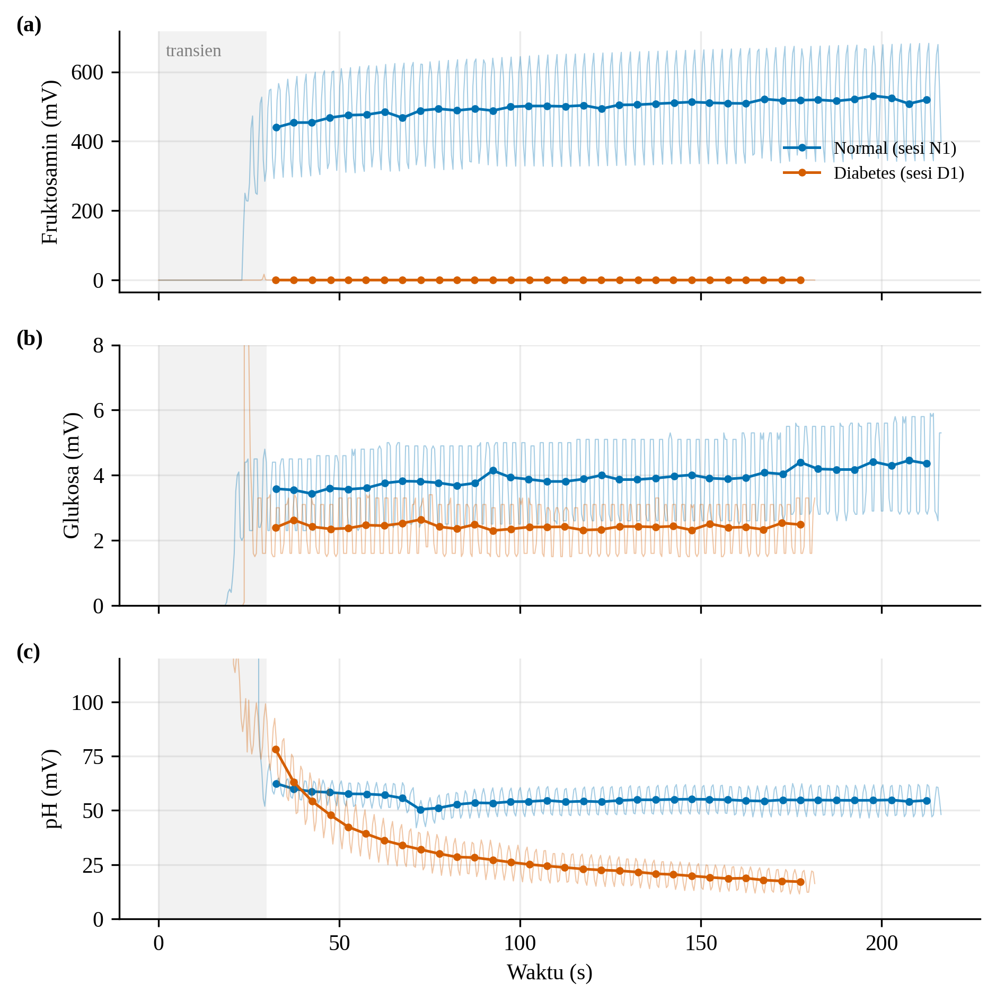
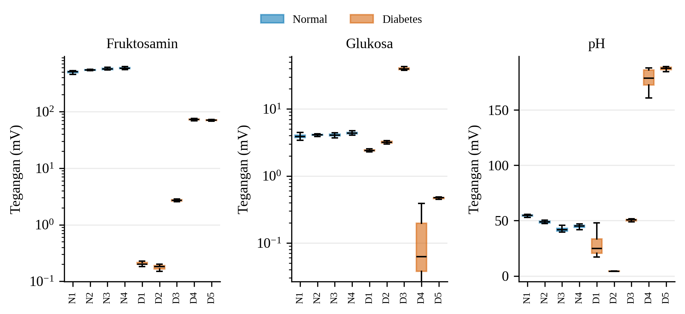
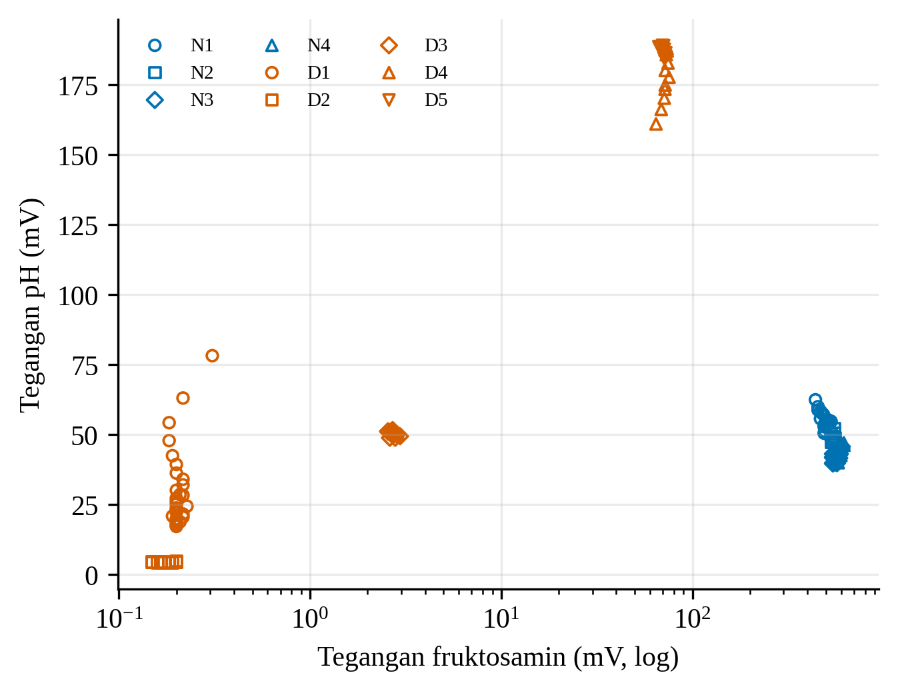
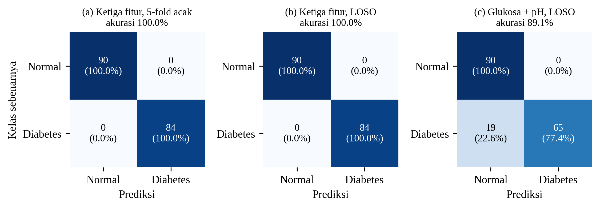
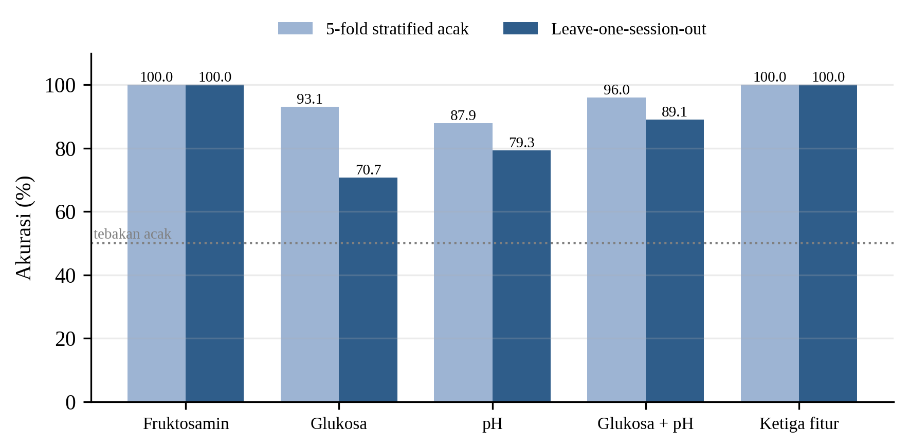

## Respons Sensor dan Klasifikasi pada Sampel Saliva

Pengujian menggunakan sembilan rekaman saliva yang diambil dengan firmware yang sama, yaitu empat sesi dari subjek kelas normal (N1–N4, glukosa darah 88 mg/dL) dan lima sesi dari kelas diabetes (D1–D5, 148 mg/dL) yang direkam pada dua hari berbeda (Tabel 2). Rekaman yang berdurasi kurang dari 30 detik, termasuk satu rekaman prediabetes, dan rekaman dari versi rangkaian sebelumnya tidak diikutsertakan. Gambar 9 memperlihatkan bahwa seluruh kanal melewati fase transien sekitar 30 detik pertama, kemudian sinyal berosilasi periodik dengan periode 1,5–2,9 detik pada ketiga kanal sekaligus. Osilasi bersama ini tidak berasal dari sampel, melainkan konsisten dengan interferensi jala-jala listrik 50 Hz yang ter-*alias* oleh laju pencuplikan sekitar 2,4 Hz. Untuk meredamnya, 30 detik pertama dibuang dan sinyal dirata-ratakan per jendela 5 detik sehingga diperoleh 174 sampel (90 normal dan 84 diabetes). Selain itu, keluaran penguat transimpedansi pada kanal glukosa berada di bawah 0,05 V pada 100% pembacaan delapan dari sembilan sesi. Artinya, arus glukosa melampaui rentang ukur penguat (Rf 100 kΩ) sehingga tegangan glukosa yang sangat kecil tersebut menunjukkan saturasi, bukan kadar glukosa yang rendah.

**Tabel 2.** Ringkasan sesi pengukuran (median tegangan fase stabil).

| Sesi | Kelas | Durasi (s) | Sampel | Fruktosamin (mV) | Glukosa (mV) | pH (mV) | Jenuh (%) |
|---|---|---|---|---|---|---|---|
| N1 | Normal | 216 | 37 | 503,6 | 3,9 | 54,7 | 100 |
| N2 | Normal | 84 | 11 | 544,7 | 4,1 | 48,8 | 100 |
| N3 | Normal | 129 | 20 | 566,4 | 4,1 | 41,6 | 100 |
| N4 | Normal | 140 | 22 | 585,5 | 4,4 | 45,3 | 100 |
| D1 | Diabetes | 181 | 30 | 0,2 | 2,4 | 24,7 | 100 |
| D2 | Diabetes | 133 | 21 | 0,2 | 3,2 | 4,3 | 100 |
| D3 | Diabetes | 93 | 12 | 2,7 | 39,8 | 50,6 | 74 |
| D4 | Diabetes | 90 | 12 | 72,1 | 0,1 | 178,8 | 100 |
| D5 | Diabetes | 74 | 9 | 71,0 | 0,5 | 187,6 | 100 |

**Gambar 9.** Respons tegangan kanal (a) fruktosamin, (b) glukosa, dan (c) pH pada sesi N1 dan D1. Garis tipis adalah pembacaan mentah, titik adalah rata-rata jendela 5 detik, dan area abu-abu adalah fase transien.

Sebaran per sesi (Gambar 10) menunjukkan bahwa variasi antarsesi pada kelas yang sama jauh lebih besar daripada variasi di dalam satu sesi. Pada kelas diabetes, tegangan pH berkisar dari 4,3 mV (D2) hingga 187,6 mV (D5), sedangkan tegangan fruktosamin berkisar dari 0,2 mV hingga 72,1 mV. Kondisi ini membuat evaluasi *five-fold stratified cross-validation* acak menjadi terlalu optimistis, karena jendela dari sesi yang sama dapat muncul pada data latih sekaligus data uji. Oleh karena itu, model SVM RBF juga dievaluasi menggunakan *leave-one-session-out* (LOSO), yaitu setiap sesi diuji oleh model yang tidak pernah melihat sesi tersebut (Gambar 12 dan Gambar 13). Dengan LOSO, akurasi kanal glukosa turun dari 93,1% menjadi 70,7%, kanal pH dari 87,9% menjadi 79,3%, dan kombinasi glukosa–pH dari 96,0% menjadi 89,1%. Seluruh kesalahan kombinasi glukosa–pH berasal dari sesi D1, yang 19 dari 30 sampelnya diklasifikasikan sebagai normal karena tegangan pH-nya masih menurun perlahan dan memasuki rentang kelas normal (Gambar 9c). Waktu inferensi model pada komputer pengolah sebesar 0,50 ms per sampel.

**Gambar 10.** Sebaran tegangan tiap sesi pada kanal fruktosamin, glukosa (skala logaritmik), dan pH.

**Gambar 11.** Sebaran sampel pada ruang fitur tegangan fruktosamin dan pH. Setiap simbol mewakili satu sesi.

**Gambar 12.** *Confusion matrix* SVM RBF: (a) ketiga fitur dengan *five-fold stratified cross-validation* acak, (b) ketiga fitur dengan *leave-one-session-out*, dan (c) glukosa–pH dengan *leave-one-session-out*.

**Gambar 13.** Akurasi SVM RBF untuk tiap kombinasi fitur pada dua skema validasi.

Model dengan ketiga fitur tetap mencapai akurasi 100% pada kedua skema validasi. Namun, pemisahan tersebut hampir seluruhnya ditentukan oleh kanal fruktosamin (Gambar 11), dan hasil ini belum dapat ditafsirkan sebagai kemampuan diagnostik karena tiga alasan. Pertama, arah perbedaannya berlawanan dengan harapan karena kelas normal justru menghasilkan tegangan fruktosamin sekitar 7–3.000 kali lebih tinggi daripada kelas diabetes. Penurunan potensial memang dapat terjadi pada elektroda berbasis asam fenilboronat ketika terbentuk ester boronat bermuatan negatif, tetapi dugaan ini belum diuji dengan larutan standar. Kedua, keempat sesi normal direkam berurutan dalam rentang 13 menit dan menunjukkan osilasi besar dengan simpangan baku 120–138 mV, sehingga perbedaan tersebut dapat mencerminkan kondisi rangkaian atau elektroda saat itu, bukan biomarka. Ketiga, setiap kelas hanya berasal dari satu subjek. Hasil yang lebih dapat dipertanggungjawabkan adalah kombinasi glukosa–pH dengan akurasi LOSO 89,1%, meskipun kanal glukosa masih berada dalam kondisi saturasi. Dengan demikian, alur akuisisi sinyal hingga klasifikasi SVM Glicovia telah berfungsi, tetapi penurunan nilai Rf atau penambahan rentang penguat untuk mengatasi saturasi glukosa, peredaman interferensi 50 Hz melalui pelindung dan rata-rata sinkron, kalibrasi tiap kanal dengan larutan standar, serta pengujian pada lebih banyak subjek dengan validasi per subjek masih diperlukan sebelum kinerja klasifikasi dapat dinilai secara klinis.
