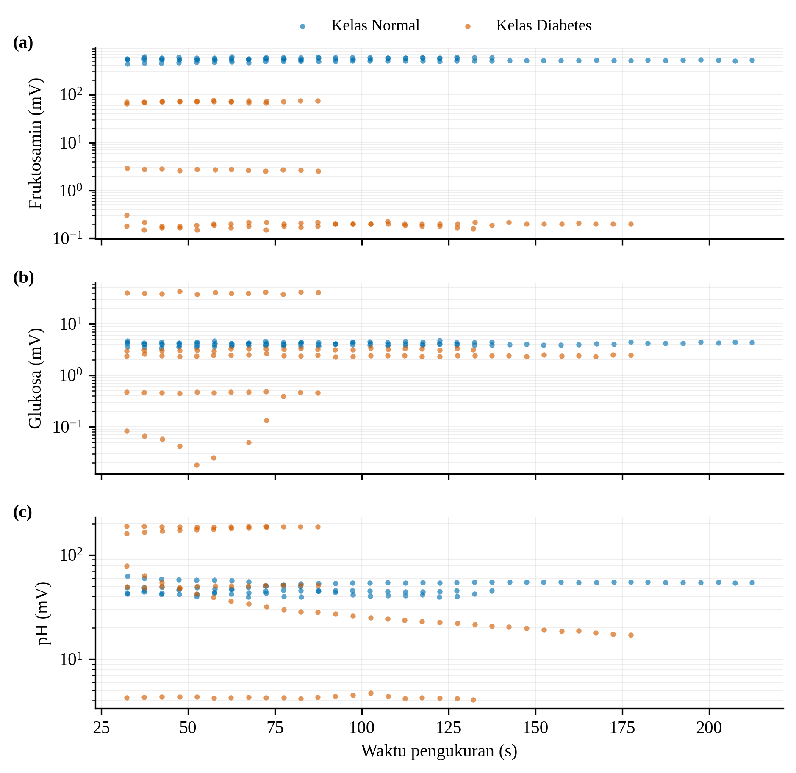
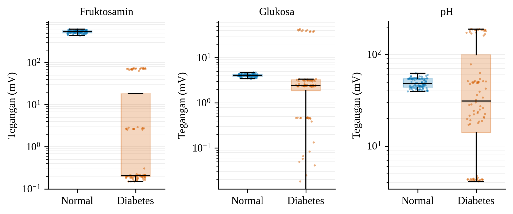
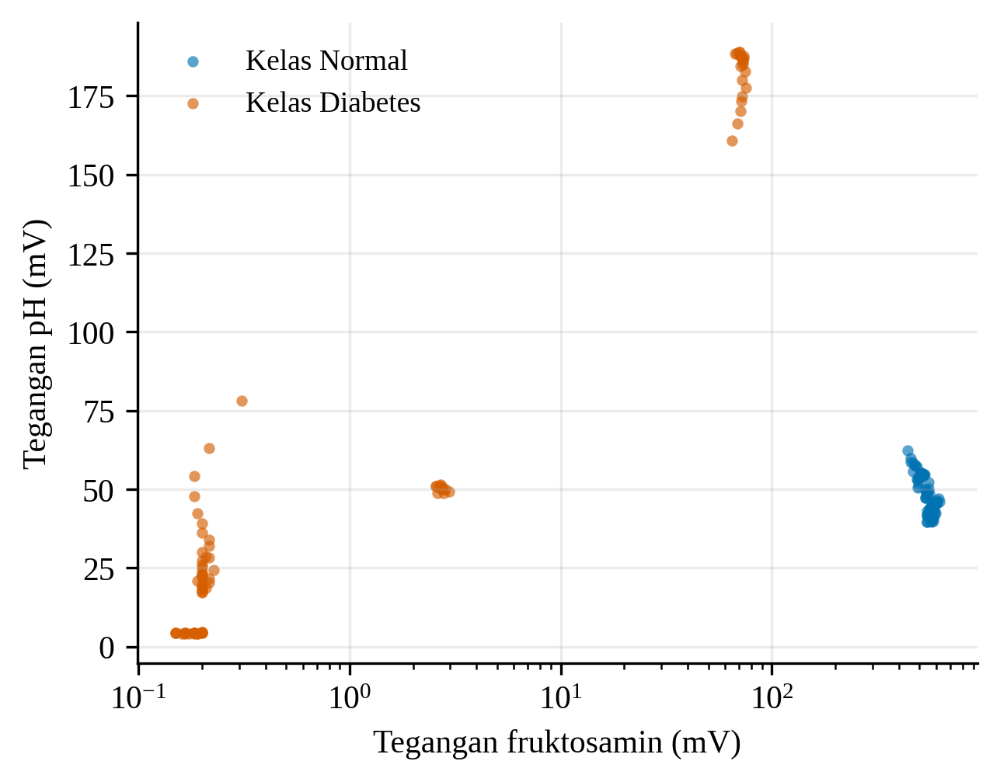

## Respons Tegangan Sensor pada Dua Kelas Data

Respons sensor dievaluasi pada dua kelas data, yaitu kelas normal dan kelas diabetes. Setiap titik pada Gambar 9 merupakan satu pengambilan data, yaitu rata-rata tegangan dalam rentang 5 detik setelah fase transien 30 detik pertama, sehingga diperoleh 174 pengambilan data (90 pada kelas normal dan 84 pada kelas diabetes). Tegangan ketiga parameter berbeda antara kedua kelas dan perbedaan tersebut bertahan sepanjang waktu pengukuran. Perbedaan paling jelas terlihat pada fruktosamin, dengan median 543 mV pada kelas normal dan 0,21 mV pada kelas diabetes. Tegangan glukosa kelas normal juga lebih tinggi, yaitu 4,11 mV berbanding 2,44 mV, dan tegangan pH kelas normal sebesar 48,1 mV berbanding 31,0 mV pada kelas diabetes.

**Gambar 9.** Tegangan (a) fruktosamin, (b) glukosa, dan (c) pH terhadap waktu pengukuran pada kelas normal dan kelas diabetes. Setiap titik adalah satu pengambilan data (rata-rata 5 detik); sumbu tegangan berskala logaritmik.

Sebaran pengambilan data pada Gambar 10 menunjukkan bahwa kelas normal menghasilkan tegangan yang sempit dan stabil pada ketiga parameter, sedangkan kelas diabetes lebih bervariasi (fruktosamin 0,15–75,5 mV dan pH 4,1–189,0 mV). Pada ruang fitur fruktosamin–pH (Gambar 11), kedua kelas terpisah sepenuhnya karena kanal fruktosamin, sedangkan kanal glukosa dan pH masih menunjukkan tumpang-tindih sebagian. Hasil ini menunjukkan bahwa perangkat mampu menghasilkan pola tegangan yang berbeda untuk kedua kelas, yang menjadi dasar bagi klasifikasi berbasis SVM. Namun, hasil ini masih bersifat awal: arah perbedaan tegangan perlu dikonfirmasi dengan larutan standar, tegangan glukosa yang kecil menunjukkan kanal masih jenuh sehingga belum mencerminkan kadar glukosa, dan variasi pada kelas diabetes yang besar menandakan bahwa kestabilan pembacaan serta jumlah data masih perlu ditingkatkan melalui kalibrasi dan validasi lebih lanjut.

**Gambar 10.** Sebaran tegangan fruktosamin, glukosa, dan pH pada kelas normal dan kelas diabetes (skala logaritmik).

**Gambar 11.** Sebaran pengambilan data pada ruang fitur tegangan fruktosamin dan pH.
