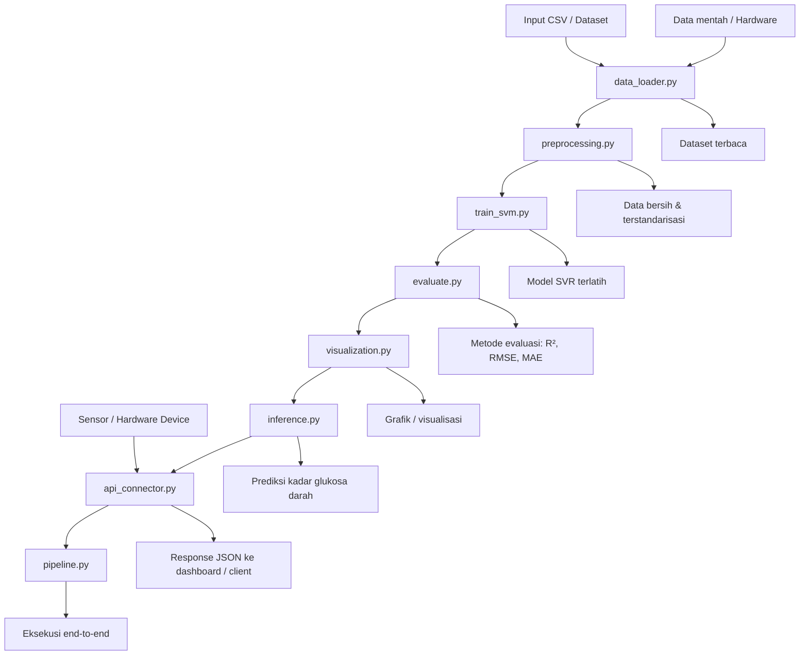

# Diagram Flow ML Pipeline (Mermaid)

## Keterangan Diagram

- `data_loader.py`: membaca dataset dari file atau sumber data.
- `preprocessing.py`: membersihkan data dan menyiapkan fitur.
- `train_svm.py`: melatih model Support Vector Regression.
- `evaluate.py`: menghitung metrik evaluasi model.
- `visualization.py`: menghasilkan visualisasi untuk analisis.
- `inference.py`: melakukan prediksi terhadap data baru.
- `api_connector.py`: menerima data dari hardware dan mengirim hasil prediksi.
- `pipeline.py`: menjalankan seluruh proses secara terintegrasi.

## Alur Singkat

Data mentah atau data dari hardware diproses oleh `data_loader.py`, kemudian melalui tahap prapemrosesan di `preprocessing.py`. Setelah itu model dilatih menggunakan `train_svm.py`, dievaluasi dengan `evaluate.py`, dan hasilnya divisualisasikan melalui `visualization.py`. Pada tahap operasional, data baru diprediksi melalui `inference.py` dan dihubungkan ke sistem melalui `api_connector.py`. Seluruh proses dapat dijalankan secara end-to-end melalui `pipeline.py`.
