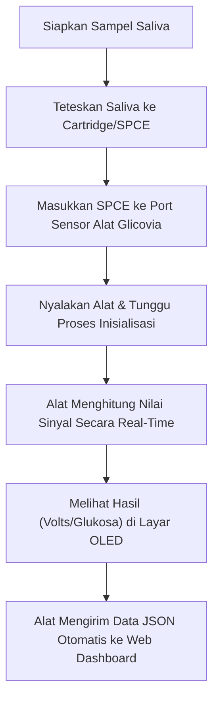

# Rancangan Sistem & Diagram Integrasi Glicovia

*Dokumen ini dapat langsung diserahkan kepada vendor elektronik beserta file `main.cpp`.*

## 1. Daftar Komponen Hardware yang Dibutuhkan

Vendor perlu memastikan komponen-komponen ini terhubung dengan stabil (terutama jalur analog yang sangat sensitif terhadap *noise*):

1. **Mikrokontroler:** **ESP32** (sebagai otak utama, WiFi, komunikasi I2C).
2. **Elektroda:** **SPCE (Screen-Printed Carbon Electrode)** (tempat sampel saliva diteteskan).
3. **Analog Front-End (AFE):** **OPA2333** (Op-Amp presisi tinggi untuk *signal conditioning* arus lemah dari SPCE).
4. **ADC:** **ADS1115** (ADC 16-bit eksternal via I2C untuk membaca output OPA2333 dengan akurat).
5. **Display Lokal:** **OLED SH1106G (128x64)** (antarmuka untuk user).

---

## 2. Diagram Alur Penggunaan Alat (User Flow)

Alur dari sisi pengguna saat melakukan tes menggunakan saliva.



---

## 3. Diagram Alur Penerjemahan Data (Dari Sensor ke Angka)

Alur konversi fisik dan kimia dari sampel saliva menjadi data digital yang dimengerti oleh software.

```mermaid
flowchart TD
    subgraph Reaksi Fisik & Kimia
        S["Sampel Saliva"] -->|Reaksi Elektrokimia| SPCE["SPCE"]
        SPCE -->|Arus Sangat Lemah (nA/µA)| OPA["OPA2333 (Op-Amp)"]
    end
  
    subgraph Konversi Elektronik
        OPA -->|Penguatan ke Tegangan Analog (0-3.3V/5V)| ADC["ADS1115 (ADC 16-bit)"]
        ADC -->|Konversi ke Nilai Digital| I2C_BUS["Jalur I2C (SDA=21, SCL=22)"]
    end
  
    subgraph Pemrosesan Firmware (ESP32)
        I2C_BUS --> MCU["ESP32 (ads.readADC_SingleEnded)"]
        MCU -->|Konversi Tipe Data| VOLT["Kalkulasi Volts (ads.computeVolts)"]
        VOLT -->|Rumus/Regresi Kalibrasi| DATA_AKHIR["Data Akhir (Glukosa, pH, Fruktosamin)"]
    end
```

---

## 4. Diagram Integrasi Hardware & Software

Arsitektur teknis yang menunjukkan bagaimana komponen fisik berkomunikasi dengan `main.cpp` dan infrastruktur cloud.

```mermaid
flowchart LR
    subgraph Hardware Layer
        SPCE["SPCE"]
        OPA["OPA2333"]
        ADC["ADS1115"]
        ESP["ESP32 (Core)"]
        OLED["SH1106G"]
    end

    subgraph Software Layer (main.cpp)
        I2C_LIB["I2C Driver (Wire.h)"]
        LOGIC["Sensor Logic & Loop()"]
        MQTT_LIB["PubSubClient (HiveMQ)"]
    end

    subgraph Cloud Layer
        BROKER["MQTT Broker (hivemq.com)"]
        WEB["Glicovia Web Dashboard"]
    end

    SPCE --> OPA --> ADC
  
    %% Hubungan I2C
    ADC <-->|I2C| I2C_LIB
    I2C_LIB <-->|I2C| OLED
  
    %% Firmware Logic
    I2C_LIB --> LOGIC
    LOGIC -->|Format JSON| MQTT_LIB
    LOGIC -->|Teks & Angka| I2C_LIB
  
    %% Network
    ESP -.->|Host| LOGIC
    MQTT_LIB -->|WiFi TCP/IP| BROKER
    BROKER --> WEB
```

---

## Catatan Tambahan Untuk Vendor:

- **Pin I2C ESP32:** Firmware pada `main.cpp` menggunakan default I2C ESP32 (SDA = GPIO 21, SCL = GPIO 22). Baik ADS1115 maupun OLED diparalel pada bus I2C yang sama namun memiliki alamat (address) berbeda (`0x3C` untuk OLED, default `0x48` untuk ADS1115).
- **Reduksi Noise:** Jalur analog dari **SPCE -> OPA2333 -> ADS1115** adalah bagian paling kritis. Gunakan teknik *routing* PCB yang baik (isolasi sinyal analog dari sinyal digital/WiFi) dan *power supply* (LDO decoupling) yang sangat bersih.
